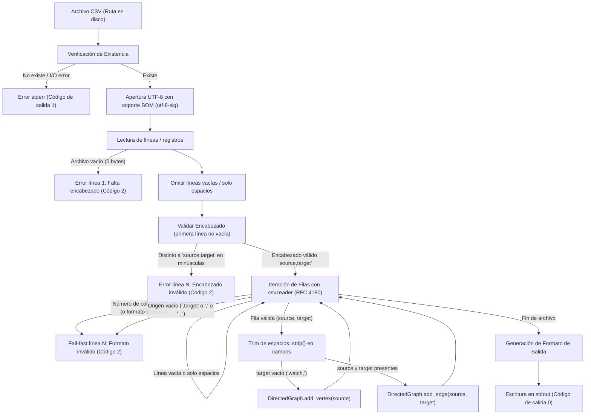

# Phase 1 Data Model: Directed Graphs

**Feature**: Directed Graphs (`001-directed-graphs`)  
**Status**: Completed  
**Date**: 2026-11-02  

---

## 1. Entidades del Dominio

### 1.1 `DirectedGraph`
Representa un grafo dirigido no ponderado en memoria.

#### Estructura y Atributos internos
- **`vertices: set[str]`**: Conjunto que almacena todos los identificadores únicos de vértices presentes en el grafo, incluyendo vértices aislados (sin aristas salientes ni entrantes).
- **`_adj: dict[str, set[str]]`**: Diccionario donde cada clave es un vértice de origen (`source`) y su valor asociado es el conjunto de vértices de destino (`targets`) hacia los que existen aristas salientes.

#### Métodos y Operaciones públicas
- **`add_vertex(v: str) -> None`**:
  - Registra el vértice `v` en `self.vertices`.
  - Asegura que `self._adj[v]` esté inicializado como un conjunto vacío si aún no existe como clave.
- **`add_edge(source: str, target: str) -> None`**:
  - Registra tanto `source` como `target` en `self.vertices`.
  - Inicializa `self._adj[source]` y `self._adj[target]` si no existen.
  - Agrega `target` a `self._adj[source]`. Si la arista ya existía, el `set` la deduplica automáticamente sin duplicación ni error.
- **`get_vertices() -> list[str]`**:
  - Retorna la lista de todos los vértices en `self.vertices` ordenada lexicográficamente en orden ascendente según puntos de código Unicode estándar (donde las mayúsculas preceden a las minúsculas).
- **`get_edges() -> list[tuple[str, str]]`**:
  - Construye todas las tuplas `(source, target)` a partir de `self._adj`.
  - Retorna la lista ordenada primariamente por `source` y secundariamente por `target` según puntos de código Unicode.
- **`vertex_count -> int`**: Propiedad que retorna `len(self.vertices)`.
- **`edge_count -> int`**: Propiedad que retorna el total de aristas dirigidas únicas (`sum(len(targets) for targets in self._adj.values())`).
- **`successors(v: str) -> set[str]`**: Retorna una copia del conjunto de sucesores inmediatos de `v`. *(Diseñado para compatibilidad con Feature 2)*.
- **`in_degree(v: str) -> int`**: Retorna el número de aristas entrantes hacia `v`. *(Diseñado para compatibilidad con Feature 2)*.

---

## 2. Reglas de Validación e Invariantes

1. **Identificadores de Vértices**:
   - Todo identificador de vértice debe ser una cadena de texto no vacía tras aplicar recorte de espacios iniciales y finales (`strip()`) [FR-013].
   - No puede contener caracteres de salto de línea (`\n`, `\r`) [Assumptions].
   - Sensibilidad a mayúsculas y minúsculas: `Math` y `math` son vértices distintos e independientes con identificadores separados [FR-014, AS-016].
2. **Aristas**:
   - Toda arista conecta un `source` con un `target`.
   - Si `source == target`, se considera un auto-bucle válido y se registra en vértices y aristas [AS-006].
   - Toda arista repetida es deduplicada silenciosamente [FR-007, AS-005].
3. **Vértices aislados**:
   - Una fila con origen definido y columna de destino vacía (por ejemplo `watch,`) registra `watch` como vértice en `self.vertices` con `self._adj['watch'] = set()`, sin generar aristas salientes [FR-005, AS-004].
4. **Determinismo**:
   - El orden de salida de vértices y aristas está 100% determinado por la comparación de puntos de código Unicode estándar ascendente [FR-006, SC-002].

---

## 3. Modelo de Parsing y Flujo de Datos



---

## 4. Estructura de Salida Determinista

Para un objeto `DirectedGraph` cargado en memoria, el formateador de salida genera exactamente:

```text
Vertices (<N>):
  <vertice_1>
  <vertice_2>
Edges (<M>):
  <origen_1> -> <destino_1>
  <origen_2> -> <destino_2>
```

- Si el grafo no tiene vértices ni aristas (`N=0`, `M=0`), se emite:
```text
Vertices (0):
Edges (0):
```
- No hay espacios en blanco adicionales al final de las líneas ni líneas vacías intermedias no especificadas.
- Todas las salidas exitosas van a `stdout` [FR-008].
