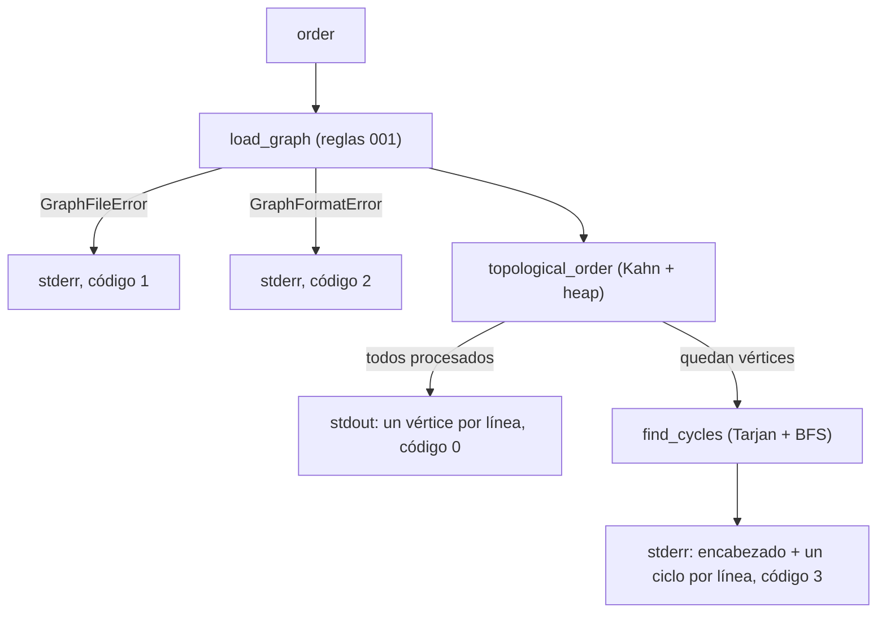

# Phase 1 Data Model: Topological Sorting

**Feature**: `002-topological-sort` · **Date**: 2026-11-03

## 1. Entidades existentes (Feature 001)

### `DirectedGraph` (`src/graphcli/graph.py`)
Sin cambios de estructura (`vertices: set[str]`, `_adj: dict[str, set[str]]`). Se agrega:

- **`in_degrees() -> dict[str, int]`**: grado de entrada de todos los vértices en una sola pasada O(V + E). Vértices sin aristas entrantes tienen 0.

## 2. Entidades nuevas (`src/graphcli/topo.py`)

### `CycleError(Exception)`
- **`cycles: list[list[str]]`**: un ciclo por grupo de dependencia circular. Cada ciclo es la lista de vértices `[v1, v2, ..., v1]` (el primero se repite al final).
- Invariantes: cada ciclo empieza en el vértice menor de su grupo; la lista está ordenada por el vértice inicial; `len(cycles) >= 1`.

### Funciones
- **`topological_order(graph) -> list[str]`**: Kahn con heap. Devuelve todos los vértices en el menor orden lexicográfico válido. Si quedan vértices sin procesar, lanza `CycleError(find_cycles(graph))`.
- **`find_cycles(graph) -> list[list[str]]`**: componentes fuertemente conexas (Tarjan iterativo) → grupos circulares → ciclo más corto por grupo (BFS desde el vértice menor, sucesores en orden Unicode, restringido al grupo).

## 3. Flujo del subcomando `order`



## 4. Formatos de salida

Éxito (`stdout`): `v1\nv2\n...\nvN\n`; grafo vacío: salida vacía.

Ciclos (`stderr`):
```text
error: <archivo>: no existe un orden topológico; el grafo tiene <K> ciclo(s):
  v1 -> v2 -> ... -> v1
```
